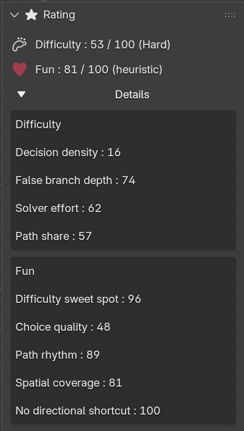

# MazeGenerator - Updated to support Blender 4.5+

Blender add-on for generating Mazes, with options for different types of cells and algorithms, 3D visualization in real time.

> **Fork Information**: This is a fork of the original [MazeGenerator by Gorgious56](https://github.com/Gorgious56/MazeGenerator), updated to support Blender 4.5+.

# UPDATE 0.5.0: BLENDER 4.5 COMPATIBILITY

This version (0.5.0) has been updated to work with Blender 4.5+.

## Key Changes for Blender 4.5 Support:

1.  **Texture System Update**: 
    - Replaced deprecated `bpy.types.Texture` property types with string references.
    - Updated texture generation logic to comply with the new API.
    
2.  **BMesh & Vertex Weights**:
    - Fixed `KeyError: "BMDeformVert[key] = x: weight keys can't be negative"`.
    - Implemented strict clamping for vertex weights to ensure they stay within the valid `[0.0, 1.0]` range.
    - Added validation for vertex group indices.
    - Updated `deform.new()` to `deform.verify()` (or equivalent logic) to ensure correct layer synchronization.

3.  **API & Property Updates**:
    - Handled removal of `use_auto_smooth` in newer Blender versions.
    - Updated Gizmo interaction to use safe property access methods.

**Note**: If you are using Blender 2.83, please use version 0.4.1. This version (0.5.0+) is specifically for Blender 4.5 and newer.

# UPDATE 0.5.1: WEAVE MAZE SUPPORT

This version (0.5.1) restores and fixes the **Weave Maze** functionality which was previously broken/disabled.

## How to Use Weave Maze:
1.  Set **Cell Type** to **Square**.
2.  In the **Maze Properties** panel, look for the **Weave Maze** option.
    -   For **Kruskal Randomized** algorithm: You can adjust the slider (0-100) to set the weave density.
    -   For **Other Algorithms**: You can toggle the option ON/OFF (this enables the potential for weave connections during generation).
3.  Click **Generate Maze**.

# UPDATE: MAZE RATING (DIFFICULTY & FUN)

Every generated maze is now rated with two scores from 0 to 100, shown in the new **Rating** panel (right below the **Path** panel in the `MG` tab).

## How to Use Maze Rating:
1.  Generate a maze (or change any parameter with **Auto Update** on).
2.  Open the **Rating** panel to read:
    -   **Difficulty** and its level: **Easy** (< 25), **Medium** (< 50), **Hard** (< 75) or **Extreme**.
    -   **Fun**, a heuristic estimate of how enjoyable the maze is.
    -   A **directional bias** warning when the maze is easier than it looks (see below).
3.  Expand **Details** to see every sub-score (0–100) behind the two totals.

## Difficulty

| Sub-score | Weight | What it measures |
|---|---|---|
| Decision density | 25% | How often the solution path forks, i.e. how many choices the player must make. |
| False branch depth | 25% | How deep the wrong branches leaving the solution go (log scale: depth 1 → 0, depth 32 → 100). |
| Solver effort | 40% | Average moves of a simulated random depth-first solver, including backtracking (log scale: 10 moves → 0, 10 000 moves → 100). Bigger mazes rate harder. |
| Path share | 10% | How much of the maze the solution path covers. |

## Fun

| Sub-score | Weight | What it measures |
|---|---|---|
| Difficulty sweet spot | 25% | Best around a difficulty of 55; too easy or too hard scores lower. |
| Choice quality | 25% | Share of wrong branches with a meaningful length: 1-cell stubs are spotted at a glance, very long ones are frustrating. |
| Path rhythm | 20% | Balanced turns along the solution: long straight corridors and constant zig-zags both score lower. |
| Spatial coverage | 15% | How much of the maze area the solution visits instead of staying in one corner. |
| No directional shortcut | 15% | How much "always head toward the goal" fails compared to a random solver. |

Fun is a heuristic, not an objective measure: use the sub-scores to judge for yourself.

## Directional Bias Warning

"Strong directional bias: easier than it looks" appears when the maze has real choices, yet a solver that always heads toward the goal avoids almost all of them. Mazes that simply have few branches are not flagged.

## Notes
-   Ratings work with every cell type, space representation, braided mazes (Keep Dead Ends) and weave mazes.
-   Ratings are not stored in the .blend file. When a file is opened, they are recomputed automatically by replaying the maze generation from the saved parameters and seed; the scene itself is not modified.
-   Installing or updating the add-on (e.g. from a .zip) while Blender is running no longer requires a restart.
-   For developers: the rating logic does not depend on Blender and is unit-tested with `python3 -m unittest discover -s tests -v`.

## The license for both the addon code and the things you generate with it are CC0 (or equivalent). You can do whatever you wish with it, no strings attached. If you do something cool, don't hesitate to start a thread here to showcase it, I'm interested. :)

Go to https://github.com/Gorgious56/MazeGenerator/releases for the latest release.

Go to https://gorgious.artstation.com/ or https://imgur.com/gallery/U5yoODH for artworks created with this add-on.

The Add-on is available in the right side panel of the 3D Viewport :

Current Features :

Cell types : Polar, Square, Triangle, Hexagon.

Algorithms : 

Space representations : Plane, Cylinder, Moebius (double), Torus

3D visualization : Stairs, Inflate

Basement :

Seed:

Steps:

Open Dead Ends:

Sparse Maze:

Weave Maze:

Bias:

Room Size (Only available with recursive algorithms):

Room Size Deivation (Only available with recursive algorithms):

Cell Inset :

Cell Thickness :

Cell Bevel (Only available when Thickness is not 0):

Black Outline (Only available with Bevel > 0) :

Wireframe :

Cell Subdivision :

Cell Shade Smooth:

Cell Decimate :

Wall Height :

Wall Thickness :

Wall Bevel :

Wall Color :

Wall Auto-hide (This automatically hides the walls when insetting the cells) :

Cell Paint Style : Neighbors Amount, Uniform, Cell Groups, Distance

Cell Randomize Colors:

Cell Hue Shift:

Cell Saturation Shift:

Cell Value Shift:

Cell Color Ramp:

